# DuetScreen7 MODERN UI CNC — Interface Guide

## ALERT WARNING
## THIS IS AT TEST PHASE
## CNC machines can cause serious injury and damage. Keep the STOP button of the machine (and a hardware emergency stop) within reach at all times. Never leave a running machine unattended.
## USING AT YOUR OWN RISK
## THIS IS 100% VIBE CODED USING CLOUDE. I AIM TO MAKE IT AS BEST TO MY UNDERSTANDING OF CNC AS POSSIBLE (IM ME) WITH AS MUCH SAFETY MECHANICS BUILD IN, BUT IM NO SOFTWARE DEVELOPED SO FOR ACTUAL CODING CLOUDE WAS USED 100%

**MODERN UI CNC for the Duet3D DuetScreen 7** is a portrait touchscreen interface for CNC mills and routers running
[RepRapFirmware](https://github.com/Duet3D/RepRapFirmware). It is built with LVGL and runs on the
[Duet3D DuetScreen 7](https://docs.duet3d.com/Duet3D_hardware/Accessories/DuetScreen) (600 x 1024, used in portrait). The same code also
compiles for x86 / Arm on Linux and macOS as a simulator window, so the whole UI can be developed and tested without a machine.

It is the DuetScreen port of [PanelDue Modern UI CNC](https://github.com/M0ti0n/PanelDue_Modern_UI_CNC): the same look, the same logic and the same macros,
plus a few additions that a bigger screen with more memory makes possible: a 3D **job preview** with a simulated part, a **console keyboard**, and more settings.

The CNC UI replaces the printer UI when the project is built with `DUETSCREEN_CNC_UI=ON`. Everything below the UI (communication, object model, Wi-Fi, updates) is stock DuetScreen.

## Table of Contents

- [Navigation](#navigation)
- [CONTROL](#control)
- [WCS](#wcs)
  - [WCS → OFFSETS](#wcs--offsets)
  - [WCS → TOOLS](#wcs--tools)
  - [WCS → PROBE](#wcs--probe)
- [JOB](#job)
  - [JOB → JOB LIST](#job--job-list)
  - [JOB → PREVIEW](#job--preview)
  - [JOB → JOB STATUS](#job--job-status)
- [MACROS](#macros)
- [SYSTEM](#system)
  - [SYSTEM → ALERT](#system--alert)
  - [SYSTEM → CONSOLE](#system--console)
  - [SYSTEM → SETTINGS → SYSTEM](#system--settings--system)
  - [SYSTEM → SETTINGS → CUSTOMIZATION](#system--settings--customization)
  - [SYSTEM → SETTINGS → JOG DIRECTION](#system--settings--jog-direction)
- [Messages and popups from the machine](#messages-and-popups-from-the-machine)
- [Notes](#notes)
- [Setting up the machine](#setting-up-the-machine)
- [Software Compatibility](#software-compatibility)
- [Compatible Hardware](#compatible-hardware)
- [Firmware Downloads](#firmware-downloads)
- [Build and test](#build-and-test)
- [Repository status](#repository-status)
- [Original project](#original-project)
- [License](#license)
- [Contributing](#contributing)

---

# Navigation

The screen has three fixed parts: the **DRO** at the top, the **page content** in the middle, and the **bottom navigation**. The pages WCS, JOB and SYSTEM
also have a row of **sub-tabs** just above the navigation.


### Bottom navigation

- **CONTROL** (joystick icon) — jog, home, rapid / slow, safe Z, your custom button.
- **WCS** (crosshair icon) — work offsets, tools and probing.
- **JOB** (list icon) — pick a file, preview it, run it and watch it.
- **MACROS** (file icon) — run the macros stored on the machine.
- **SYSTEM** (wrench icon) — alerts, console and settings.
- **STOP** (red octagon) — emergency stop. It is on every page and keeps working **over every popup**.

Each page opens on its first sub-tab and **remembers the last sub-tab you used**.

### DRO (digital read-out)

- **Full DRO** (CONTROL and WCS) — one row per axis with the **WORK** position (the active work coordinate system is named, e.g. `WORK G54`),
  the **MACHINE** position, and a **ZERO** button per axis. ZERO sets that axis to 0 in the active work coordinate system (`G10 L20`).
- **Compact DRO** (JOB, MACROS, SYSTEM) — positions only, no buttons, to leave room for the page.
- **T tile** — shows the tool number. A tap switches the spindle **on** (at the set speed) or to **standby** (`M5`).
- **S tile** — spindle speed. A tap opens a numpad. The set speed stays on the tile while the spindle is in standby.
- **F tile** — feed. A tap opens the **SLOW jog feed** presets (the speed used by SLOW on CONTROL). It also works while a job runs.

### Popups

- All questions and messages look the same: a title, a text and two big buttons, a red **X** (cancel) and a green **check mark** (confirm).
- Dangerous actions (homing, deleting a file, factory reset, running a job) **always ask first**.
- Numbers are typed on a **numpad**, text on a **keyboard**.

### Job locks

- While a job **runs**, the pages that could disturb it are locked (greyed). A tap on a locked button tells you why.
- While a job is **paused**, jogging works again, homing does not.

---

# CONTROL

The page for moving the machine by hand.

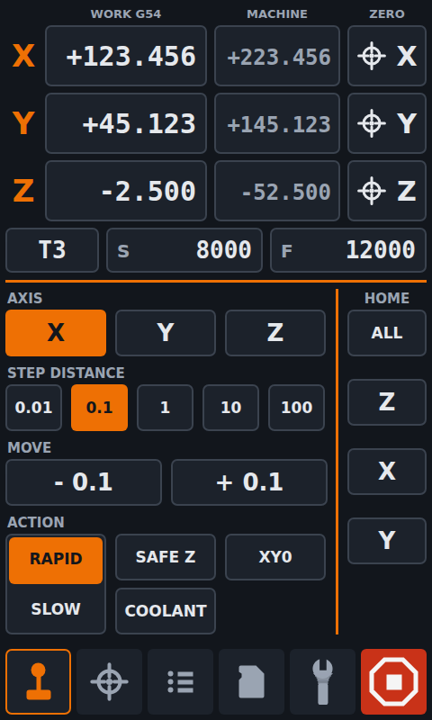

### CONTROL

Layout from top to bottom: **AXIS**, **STEP DISTANCE**, **MOVE**, **ACTION**, and the **HOME** column on the right.

### Important controls

- **AXIS `X` `Y` `Z` (`A` on a 4-axis machine)** — picks the axis to move. No axis is picked at power-up.
- **STEP DISTANCE `0.01` `0.1` `1` `10` `100`** — how far one tap moves, in mm.
- **MOVE `- step` / `+ step`** — moves the picked axis by the step. Moves are relative (`G91 ... G90`). The arrows can be changed in SETTINGS → JOG DIRECTION.
- **RAPID / SLOW** — a two-button switch.
  - **RAPID** uses fast moves (`G0`).
  - **SLOW** uses `G1` at the SLOW jog feed (set with the **F** tile or in SETTINGS).
- **SAFE Z** — runs `0:/macros/safe_z.g`, your own safe retract. Needs X, Y and Z homed.
- **XY0** — runs `0:/macros/goto_xy0.g`, moves to X0 Y0 of the work offset. Needs X, Y and Z homed.
- **COOLANT** (or **VACUUM**) — switches your coolant or dust shoe on and off (`aux_on.g` / `aux_off.g`). The name is set in SETTINGS → COOL / VAC.
- **CUSTOM 1** — your own macro button. Shown only when a macro is assigned (SETTINGS → CUSTOM 1). A macro whose name starts with `!` asks first.
- **HOME `ALL` `Z` `X` `Y` (`A`)** — homes everything or one axis. **Always asks first** ("clear of stock and clamps?").

### Behaviour

- **Idle timeout.** When you do not touch the axis or step buttons for a while (default 5 s, SETTINGS → IDLE TIMEOUT), the selection is cleared. A tap on MOVE with nothing selected says *"Select an axis first"*. This prevents an accidental move after you walk away.
- **Large jogs.** Steps of 10 and 100 mm are not queued: while one of those moves is still running, another tap is refused.
- **Job running:** the whole page is locked. **Job paused:** everything works except HOME.
- A **greyed** button means "not possible now" (not homed, job running, and so on).

---

# WCS

**Work Coordinate Systems.** Where is the zero of the part? Three sub-tabs: **OFFSETS**, **TOOLS** and **PROBE**. The full DRO stays at the top.

## WCS → OFFSETS

Shows and edits the offsets of the six work coordinate systems **G54, G55, G56, G57, G58, G59**.

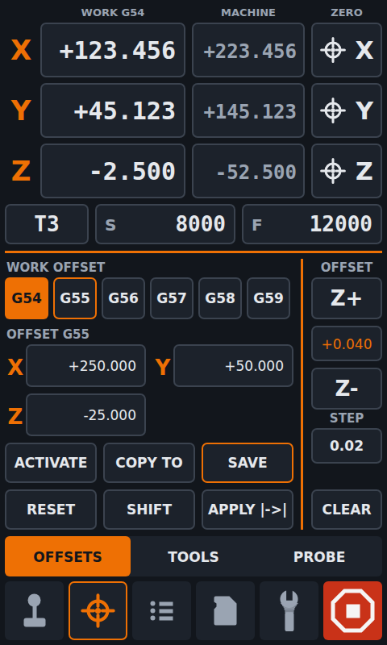

### Important controls

- **G54 ... G59** — a tap *views* that system. The **active** one is filled with the accent colour, the **viewed** one has an accent outline.
- **X / Y / Z / A cells** — the offset of the viewed system. A tap opens a numpad (`G10 L2`). The numpad has a **POS** button that enters the offset which makes the machine's current position equal 0.
- **ACTIVATE** — makes the viewed system the active one.
- **COPY TO** — copies the viewed offsets to another system. A form asks for the target and the axes. If the target already has offsets, it shows *old → new* and asks first.
- **SAVE** — saves the offsets on the machine (`M500 P10`). It gets an **accent outline while there are unsaved changes** (also changes from ZERO, probing or DWC).
- **RESET** — sets the viewed system back to 0. Asks first.
- **SHIFT** — adds an amount to the offset: pick the axes, then type the amount on the numpad.
- **APPLY OFFSET** — folds the babystep (the OFFSET column) into the Z of the active system. Asks first.

### OFFSET column (babystepping)

Live Z adjustment, **also during a job**, without touching the work offset.

- **Z+ / Z-** — raises or lowers Z by the step (`M290`). The tile between them shows the total.
- **STEP** — opens the step presets (0.5 and 1 mm are not offered while a job runs).
- **CLEAR** — removes the babystep again (`M290 R0 Z0`). Asks first.

### During a job

Only the **job's own work system** is locked (editing, RESET, SHIFT, COPY TO into it and ACTIVATE are refused). The other five stay editable. APPLY OFFSET is refused while a job runs.

## WCS → TOOLS

The tool table of the machine: whatever the machine defines with `M563` (up to 32 tools, T0 to T99).

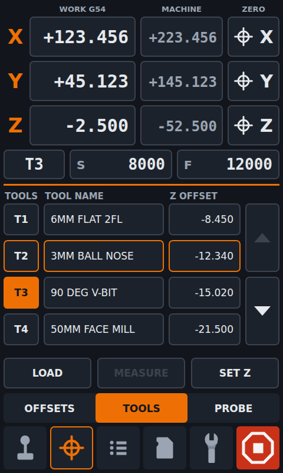

### Important controls

- **T# tile / name** — selects a row. The **loaded** tool has an accent-filled T# tile, the selected row an accent outline.
- **Z OFFSET tile** — selects the row and opens **SET Z**.
- **Up / down arrows** — page through the list (4 rows at a time).
- **LOAD** — loads the selected tool.
  - No tool known: it asks **"Is T# in the spindle?"**. *YES* only tells the machine (nothing moves), *NO* does a real tool change.
  - Another tool loaded: it asks to confirm the tool change.
- **MEASURE** — measures the loaded tool on your tool setter (`0:/sys/toolchange/measure_tool.g`). Needs **TOOL SETTER** switched on in SETTINGS.
- **SET Z** — a numpad for the Z offset of the selected tool (`G10 P# Z...`, then `M500 P10`).

LOAD and MEASURE need X, Y and Z homed. All of TOOLS is refused while a job runs or is paused.

## WCS → PROBE

Finds the work zero with a touch probe, through your own probe macros.

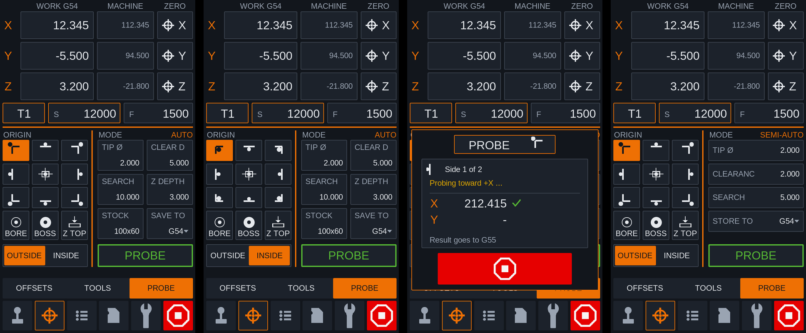

### Important controls

- **ORIGIN picker** — where the zero goes. One at a time.
  - Corners and edges `TL TC TR / ML MC MR / BL BC BR` (top / middle / bottom, left / centre / right of the stock).
  - **BORE** — centre of a hole.
  - **BOSS** — centre of a post.
  - **Z TOP** — top of the stock.
- **MODE label** (top right) — **AUTO**, **SEMI-AUTO** or **MANUAL**. Chosen in SETTINGS → PROBE MODE.
- **PROBE tile** — the probe state: green outline **OPEN**, red outline **CLOSED** (triggered).
- **RUN PROBE / START** — starts the macro of the mode.

### Important parameters

Typed on the numpad and kept on the machine. Each mode shows its own:

- **TIP Ø** — probe tip diameter.
- **CLEAR D** — clearance distance.
- **SEARCH** — search distance.
- **Z DEPTH** — how deep to go for side probing.
- **STOCK** — stock size (X, then Y).
- **SAVE TO** — the work system the result is stored in (G54 ... G59).

### Probe macros

- **AUTO** — `0:/sys/probe/probe_auto.g`. The machine does everything. A progress popup shows the side being probed and the results, with a wide **STOP**. It closes when the macro ends.
- **SEMI-AUTO** — `0:/sys/probe/probe_semi.g`. You jog near the stock and press **PROBE**, the machine does the touch.
- **MANUAL** — `0:/sys/probe/probe_manual.g`. You jog to touch the stock with the tool and press **READ**.

SEMI-AUTO and MANUAL ask through jog prompts: *"Move near [side] side of stock, press PROBE"* and *"Touch [side] side of stock and press READ"*, with the axis buttons in the popup.
**OK** continues, **X** cancels. Probing is refused during a job, when the machine is not idle or not homed, and (AUTO / SEMI-AUTO) when the probe is already closed.

---

# JOB

Files, preview and the running job. Three sub-tabs: **JOB LIST**, **PREVIEW** and **JOB STATUS**. The compact DRO stays at the top.

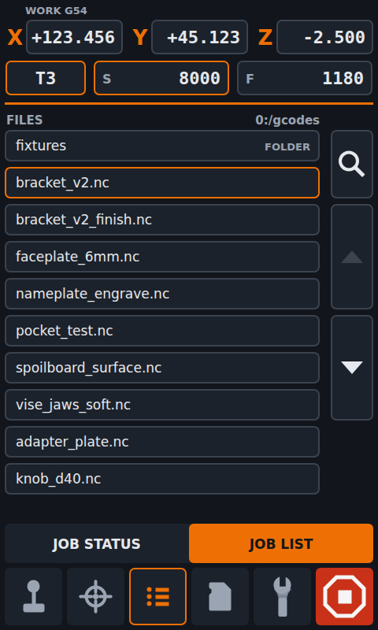

## JOB → JOB LIST

### Important controls

- **File list** — 10 rows per page, folders first, then files. It is read fresh every time you open the tab. A tap on a **folder** opens it (`..` goes back).
- **Tap a file** — selects it. **Tap it again** to open the **JOB popup**.
- **JOB popup**
  - **Trash** — deletes the file (asks first, `M30`; not allowed for the running job).
  - **X** — cancels.
  - **Check mark** — opens the file in **PREVIEW**, where you start it.
- **SEARCH** — opens the keyboard. The list filters as you type (not case-sensitive, the match is in the accent colour). **ENTER** keeps the filter, **X** clears it.
- **Up / down arrows** — page through the list.
- **SD** — only shown when a second card is mounted: goes to the next card (`1:/`).

A job is **never started from the list directly**. You always see the preview first, and the RUN tile in PREVIEW starts it.

## JOB → PREVIEW

A 3D picture of what the G-code will do, drawn on the screen from the file. Use it before the run (to check zero, stock and the order of operations) and during the job (to see where the machine is).

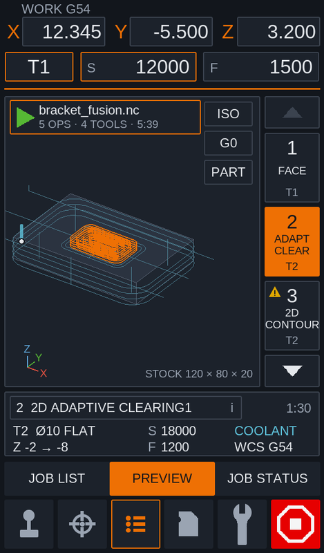
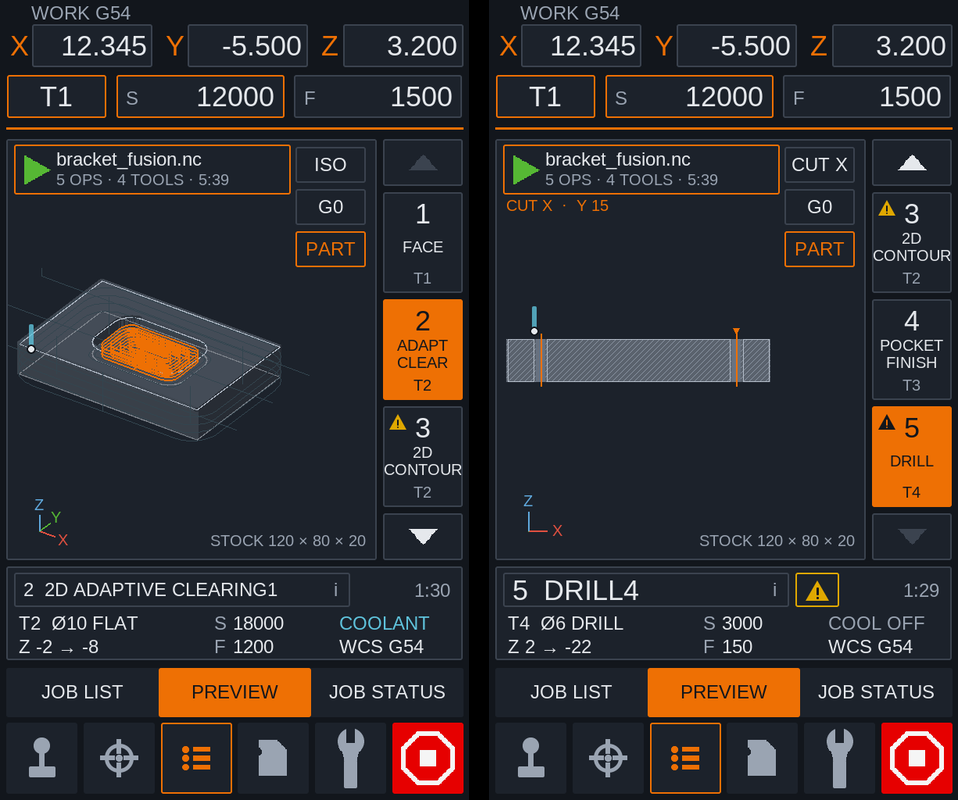
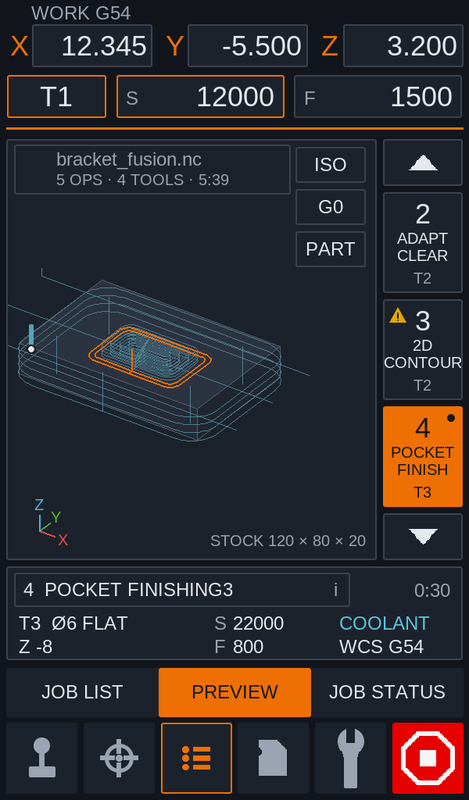

### Important controls

- **File tile (top left) = RUN**
  - Accent outline and a green play triangle: the job can start. A tap asks *"Do you want to RUN this job?"* and starts it (`M32`).
  - Grey, no triangle: it cannot start now (a job is running, the machine is busy or not connected). A tap says why.
- **ISO / TOP / FRONT / SIDE** — cycles through the views. A **double tap** on the picture goes back to ISO. **Drag** to rotate.
- **G0** — shows the rapid (non-cutting) moves of the selected operation.
- **PART** — shows the **simulated part**: what the stock looks like after the selected operation. On by default.
- **RUNNING** — only during a job, when you look at another file: goes back to the running job.
- **Operation strip (right)** — one button per operation: number, short name and tool (`T2`). Arrows page through them. The selected operation is drawn in the accent colour, the others dimmed. A small **triangle** on a button marks an operation with warnings.
- **Info strip (bottom)** — number and name of the operation, time, tool (diameter and type), Z range, S, F, coolant and work system. Two small buttons appear when needed:
  - **i** — opens the info popup (X / Y and Z range, cut and rapid length, plunge feed, tool description).
  - **Amber triangle** — opens the WARNING popup, one line per problem and its reason.

### PART (simulation)

The simulation removes material along every cutting move with the real tool shape: flat end mill, ball end, V-bit / chamfer / engraver as a cone, drills as a cone with the tip angle.

- **ISO** — a see-through "glass" part, so paths inside pockets and holes stay visible.
- **TOP** — shaded by depth (deeper is darker).
- **FRONT / SIDE** — a drawing. Visible edges are solid, hidden pockets and holes are dashed.

### Cut point and sections

- Tap a cutting line to place a **cut point** (a crosshair). It also selects the operation of that line.
- **FRONT** and **SIDE** then become **CUT X** and **CUT Y**: sections through the point with a hatched cut face, to check depths and wall thickness.
- Tap an empty spot to remove the point.

### Warnings

Informational, they **never block** a job:

- cutting below the stock bottom
- cutting moves before the spindle is switched on
- a tool that is not in the machine's tool table
- X / Y outside the axis limits with the work offset of that operation

In the RUN question the two serious ones (spindle off, missing tool) ask again: *"RUN anyway?"*

### Tool marker

A small tool shows where the machine's tool really is (when the active work system matches the one of the selected operation). Before RUN it is a quick check of your zero. During the job you watch the tool move.

### During a job

- PREVIEW follows the running operation and marks it. A pick by hand stays for 15 s.
- The moves that are already done turn **grey** as the job runs.
- With PART on, the part shows the operations finished so far.
- Another file (the next job) can be opened from JOB LIST. SETTINGS → **PREVIEW IN JOB** decides what is allowed: ANY FILE, RUNNING JOB only, or OFF.

### How the file gets here

RRF cannot send a file over USB or UART, so PREVIEW downloads the G-code over the **network** (the way DWC does), even when commands go over USB. Files up to 32 MB.
Without a network you still get the RUN tile, only no picture. If the machine asks for a password, tap the notice and type it.

### What the G-code can contain

All optional, but it makes the preview better:

- **Operation names** — Fusion 360 comments, FreeCAD `(Begin operation: ...)`, or your own `;CNC_OP Name`.
- **Tools** — Fusion's tool header lines, or `;CNC_TOOL T1 D=6 TYPE=FLAT`.
- **Stock** — `;CNC_STOCK X=120 Y=80 Z=20`. Without it, the box around the cutting moves is shown (labelled TOOLPATH).
- Tools the job creates itself with `M563 P5 ...` are not reported as missing.

## JOB → JOB STATUS

Opens by itself when a job starts or when a tool change prompt arrives.

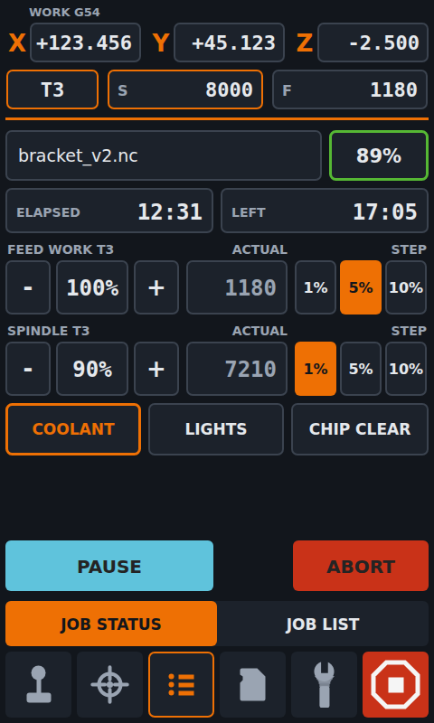

### Important controls

- **Progress tile** — file name and percent. Green: running. Amber: tool change. Cyan: paused. After the job: **DONE** or **ABORTED**.
- **ELAPSED / LEFT** — time since the start and the estimate to go.
- **COOLANT / CUSTOM 2 / CUSTOM 3** — coolant on / off, and your own two macro buttons for use during a job.
- **Tool change row** — only when needed. A machine message *"TOOL..."* (blinking amber outline, **OK** continues), or *"TOOL CHANGE T3 >>> T5"* while an automatic change runs.
- **PAUSE / RESUME** — pauses the job and resumes it. Asks first.
- **ABORT** — stops the job. It **pauses first, then cancels** (`M25`, then `M0`). When the job is already paused, it cancels at once. Asks first.

### Feed override

- **FEED WORK** — the feed override of the **current tool** (`M220`): `-` / `+` buttons, a tap on the percent opens the numpad, **1% / 5% / 10%** pick the step. The tile shows the actual feed.

### Spindle override

- **SPINDLE** — the spindle override of the current tool, same buttons. RRF has no spindle override, so the panel emulates it by resending the speed (programmed speed x override).

Overrides are **per tool** and all go back to 100 % at the end of the job. The limits (default feed 10 to 200 %, spindle 50 to 150 %) are set in SETTINGS → OVERRIDES.
An error during a job is shown as **ALERT !** over everything.

---

# MACROS

The macros on the machine (`0:/macros`), as a **list** (11 rows) or a **grid** (2 x 5 tiles). The compact DRO stays at the top.

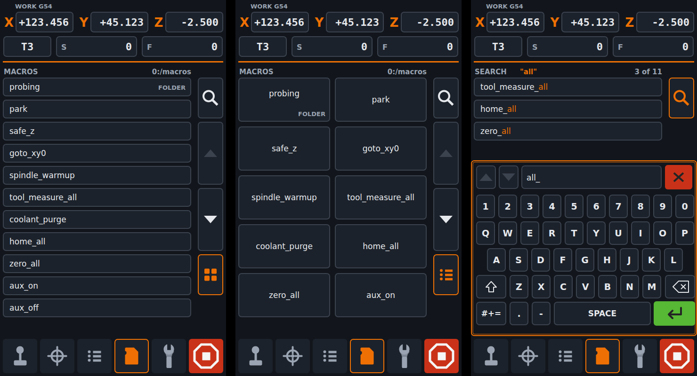

### MACROS / SEARCH

- **SEARCH** — keyboard with a live filter on the macro names of the open folder. **ENTER** keeps the filter, **X** clears it.

### Important controls

- **Macro** — a tap asks *"Do you want to run this macro?"*, then runs it (`M98`). Not allowed while a job runs, allowed while paused.
- **Folder** — opens it. `..` goes back up.
- **Up / down arrows** — page through the list.
- **LIST / GRID** — switches the view (the button sits where the SD button is on JOB LIST).

### Macro display-name rules

Names are tidied for display: a leading `!`, a leading number such as `12_`, and the `.g` extension are hidden. A `!` still makes CUSTOM macros ask first.

---

# SYSTEM

Three sub-tabs: **ALERT**, **CONSOLE** and **SETTINGS**. The compact DRO stays at the top.

## SYSTEM → ALERT

The history of the machine's **errors and warnings**, newest first: 10 rows per page, up to 5 pages (50 entries).

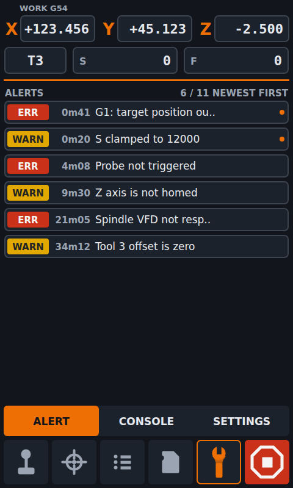

### Alert types

- **ERR** (red) — an `Error:` line of a machine reply.
- **WARN** (amber) — a `Warning:` line of a machine reply.
- An accent **dot** marks an unread one.

Tap a row to read the whole text in a popup (the row is then read). A repeat of the newest only refreshes it, so one stuck error does not flood the list.
The list is kept until power off (there is no CLEAR).

## SYSTEM → CONSOLE

A G-code terminal.

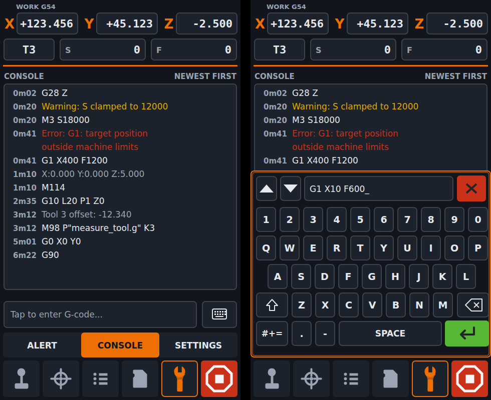

### Important controls

- **Log** — 15 lines, **newest message on top**, with the age of each. Colours: typed command (normal), reply (muted), `Warning:` amber, `Error:` red. Long replies wrap.
- **Input line / KEYBOARD** — opens the keyboard.
  - **ENTER** sends and stays open for the next command.
  - **Up / down** step through the last 5 commands.
  - **X** closes it and keeps the unsent text for next time.

## SYSTEM → SETTINGS → SYSTEM

Three pages (arrows at the bottom). A tile opens a popup with the choices; most changes take effect at once. Page 1 is stored **on the screen**.

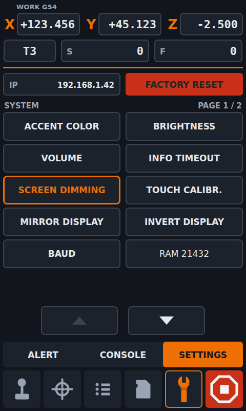

### Important settings

- **ACCENT COLOR** — the highlight colour of the whole UI. **The UI restarts** to apply it.
- **BRIGHTNESS** — screen brightness.
- **INFO TIMEOUT** — how long machine replies stay on screen: 0 s (not shown), 3, 6 or 10 s.
- **SCREEN DIMMING** — dim after OFF / 1 / 5 / 10 minutes without touch.
- **SCREEN ROTATION** — NORMAL or UPSIDE DOWN, for how the screen is mounted.
- **SOUND** — OFF, BUZZER, or one of 5 speaker sounds (touch click and the `M300` beeps of the machine).
- **CONNECTION** — how the screen talks to the machine: **UART**, **USB** or **NETWORK** (then type the machine's address). Not changeable during a job.
- **SPLIT OPERATIONS** — PREVIEW: **AUTO** (operations from names, or guessed when a tool is used twice) or **TOOL CHANGES** (only split at tool changes).
- **PREVIEW IN JOB** — **ANY FILE**, **RUNNING JOB** or **OFF**: what PREVIEW may show and download while a job runs. OFF avoids downloads during a job (useful on a slow Duet 2 WiFi).
- **ABOUT** — version and connection.
- **FACTORY RESET** — choose **SCREEN**, **MACHINE** or **BOTH**. Asks first. SCREEN returns the screen settings, MACHINE the CNC settings stored on the machine.

## SYSTEM → SETTINGS → CUSTOMIZATION

Page 2. These settings are stored **on the machine** in `0:/sys/cnc-settings.g`, so they follow the machine, not the screen.

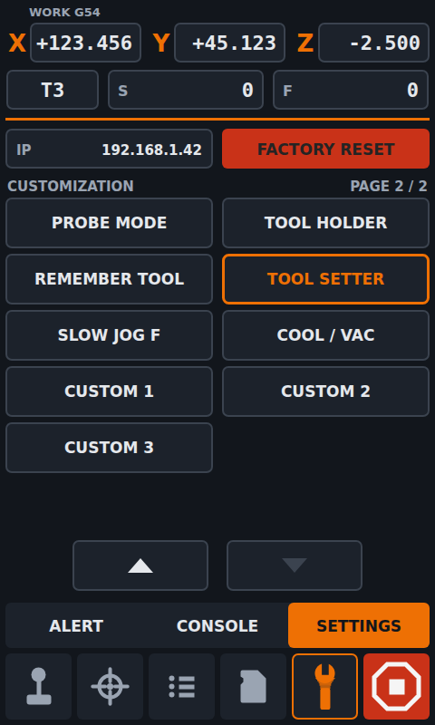

### Important settings

- **PROBE MODE** — AUTO / SEMI-AUTO / MANUAL (see WCS → PROBE).
- **TOOL HOLDER** — **ER COLLET**: the tool length changes with every tool, so it is measured after a change. **TOOL HOLDER**: fixed-length holders.
- **REMEMBER TOOL** — on: the last loaded tool is remembered by the machine (written to `sys/cnc-lasttool.g`).
- **TOOL SETTER** — on: enables MEASURE on WCS → TOOLS.
- **SLOW JOG F** — the feed of the SLOW jog (same as the F tile).
- **COOL / VAC** — whether the button on CONTROL is called COOLANT or VACUUM.
- **IDLE TIMEOUT** — CONTROL forgets the picked axis and step after OFF, 5, 10, 30 or 60 s.
- **JOG PRESETS** — the six feed values offered by the F tile (mm/min). They stay sorted.
- **OVERRIDES** — the limits of the JOB STATUS overrides: FEED MIN / MAX, SPINDLE MIN / MAX (%).

### Custom-button locations

- **CUSTOM 1** — appears on **CONTROL**.
- **CUSTOM 2 and CUSTOM 3** — appear on **JOB STATUS**.
- Each one has three choices: **MACRO** (you pick it on the MACROS page, where the label reads SELECT), **LABEL** (the button text, typed on the keyboard) and **CLEAR**.

## SYSTEM → SETTINGS → JOG DIRECTION

Page 3, also stored on the machine.

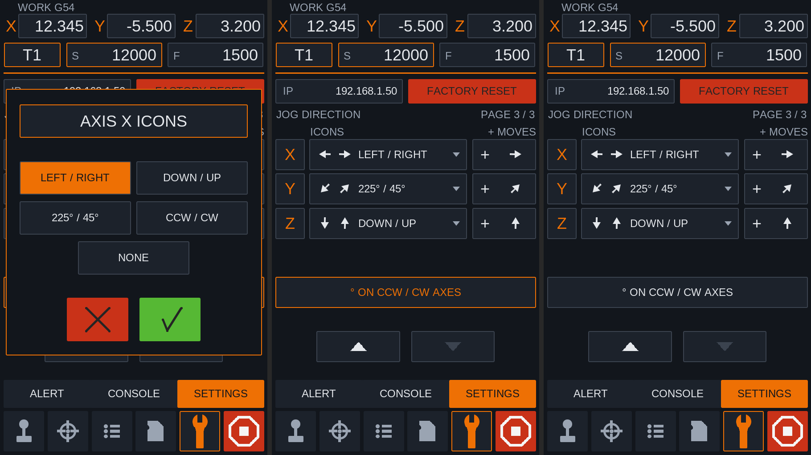

- **Icon pair per axis** — the arrows shown on the MOVE buttons: LEFT / RIGHT, DOWN / UP, 225° / 45°, CCW / CW or NONE, and where the **+** is.
- **° ON CCW / CW AXES** — adds a "°" to the step buttons of a rotary axis.
- These also apply to the jog prompts of the probing popups.

> Settings are written to the machine one line at a time and verified. If the machine does not keep a value, an ALERT says so.

---

# Messages and popups from the machine

The machine can talk to the screen, and the UI shows it the same way everywhere:

- **Replies** to commands (for example errors) pop up for **INFO TIMEOUT** seconds. An *Error* reply is titled **ALERT !**. Replies never cover a popup you are using or a prompt the machine waits for.
- **`M117` display messages** show as a MESSAGE popup with a check mark.
- **`M291` messages** (from macros and G-code) are all supported: plain messages, OK, OK / cancel, jog prompts, **choices** (S4, buttons), **numbers** (S5 / S6, numpad within the allowed range) and **text** (S7, keyboard). The **X** is shown only when the message has a cancel button.
- **Tool change prompts** (`M291` titled `TOOL...`) during a job go to the tool change row on JOB STATUS instead of a popup.
- **Errors during a job** are always shown as **ALERT !**, also over other popups.

---

# Notes

- **Test phase.** The UI is tested in the simulator against a fake Duet (`scripts/fake_duet.py`) and by automated tests. It has **not yet been run on a real DuetScreen with a real machine**. Check every new function without a tool and without stock first.
- **Rotary dial.** The hardware dial of the PanelDue version is not implemented (not tested on PanelDue either).
- **Connection.** USB is recommended by Duet3D for commands. The network is used only to download the job file for PREVIEW.
- **Duet 2 WiFi.** Downloads during a job can be slow. Use SETTINGS → PREVIEW IN JOB → OFF if the job is sensitive to it.
- **Preview is a guide.** The simulated part is made from the G-code only. It does not know your fixtures or clamps, and it is not a substitute for a dry run.

---

# Setting up the machine

The CNC UI uses a few normal RRF files on the machine.

1. **Settings file.** Add `M98 P"0:/sys/cnc-settings.g"` to `config.g` so the settings are loaded at power-on. The globals are guarded in the file, so `config.g` does not need to declare them. The UI creates the file the first time a setting is changed.
2. **Macros the buttons call** (create the ones you use):
   - `0:/macros/safe_z.g` — CONTROL → SAFE Z
   - `0:/macros/goto_xy0.g` — CONTROL → XY0
   - `0:/macros/aux_on.g`, `0:/macros/aux_off.g` — CONTROL → COOLANT / VACUUM
   - `0:/sys/probe/probe_auto.g`, `probe_semi.g`, `probe_manual.g` — WCS → PROBE
   - `0:/sys/toolchange/measure_tool.g` — WCS → TOOLS → MEASURE
3. **Probe and tools.** Define the probe in `config.g`. The tool table is whatever you define with `M563`.
4. **G-code for the preview.** See [What the G-code can contain](#what-the-g-code-can-contain).
5. **Connection.** USB for commands plus the network for the preview download, or NETWORK only, or UART.

---

# Software Compatibility

- **RepRapFirmware 3.6.2 or newer** (the DuetScreen requirement), standalone mode. SBC mode (DSF) is expected to work but has not been checked.
- Tested against the fake Duet in the simulator. Real machine testing is still to be done.

# Compatible Hardware

- **Duet3D DuetScreen 7** (600 x 1024, T113-S3), used in portrait (rotated by software).
- Boards: Duet 3 and newer, BTT Scylla, and Mellow / TeamGloomy-supported STM32H7 boards are the targets. Duet 2 WiFi should work too (slower file download). None of them tested yet.

# Firmware Downloads

### Latest builds

Releases: <https://github.com/M0ti0n/DuetScreen7_MODERN_UI_CNC/releases>

To install, follow the DuetScreen instructions: download `sdcard.img` from the release page, flash a microSD card (balenaEtcher, Rufus, or `dd` on Linux) and power the screen on from it.


 Here is the order:

1. Download the image. Open Releases and find v0.1.0-cnc-rc1, which is marked pre-release. Download sdcard.img. Note its size, because the SD card must be at least that large. You can ignore the other two files for now.

2. Write it to an SD card.

Use balenaEtcher or Raspberry Pi Imager. In Imager choose Choose OS → Use custom and pick the .img. If Imager refuses or complains about the file, use Etcher instead.
Use a card you don’t need. Writing erases everything on it.
When it finishes, Windows may say the card is unreadable or offer to format it. Click Cancel or ignore it. That is normal, because the card has Linux partitions.

3. Boot the display.

Power the display off and put the card in its SD slot.
Power it on and wait. The first boot takes longer than usual.
Duet’s docs say the first-boot options on the card come from BOOT.md. You don’t need to set anything for a first test.

4. Check it. You should see the CNC interface with the bottom navigation, and not the stock Duet screen. Connect it to your machine (SETTINGS → connection, USB or network) and test the tabs.

If something goes wrong:

Screen stays black or shows the stock UI: tell me exactly what you see, and whether the card was inserted at power-up. I haven’t verified whether the display always prefers the card over its internal storage.
Anything odd on screen: take a photo and describe the steps.
Going back to stock: remove the card and reboot. That does not touch the internal NAND.

I haven’t seen this build run on the real display, so the first boot is the real test. Tell me what happens.

---

# Build and test

```bash
# PC simulator: opens a 600 x 1024 window
cmake --preset Simulation-Release -DDUETSCREEN_CNC_UI=ON
cmake --build --preset Simulation-Release

# Screen (T113): runs rotated by 90 degrees
cmake --preset T113-Release -DDUETSCREEN_CNC_UI=ON
```

With the option OFF (default) the build is the normal printer UI.

**Without a machine: the fake Duet.** `scripts/fake_duet.py` pretends to be a CNC Duet on the network, so every page of the simulator can be used live
(homing, jogging, work offsets, tools, probing, jobs, macros, messages, settings). It needs only Python 3.

```bash
python3 scripts/fake_duet.py                          # terminal 1: listens on 127.0.0.1:8080
./out/build/CNC-Simulation-Release/DuetScreen         # terminal 2
```

In the simulator: SYSTEM → SETTINGS → CONNECTION → NETWORK, address `127.0.0.1:8080`.

**Tests.** Unit and screenshot tests run with `ctest -j1` in the build folder. Reference pictures are in `tests/ref_imgs/cnc/`.
More details (file overview, robustness notes, status of every part) are in [docs/CNC_UI.md](docs/CNC_UI.md).

---

# Repository status

Test phase. All pages are implemented (CONTROL, WCS, JOB, MACROS, SYSTEM, start-up splash, machine messages). Still open: a read-only G-code view in PREVIEW,
sorting in JOB LIST, a Millennium Machines (Milo / MOS-nxt) mode, and checks on real hardware.

# Original project

- [Duet3D/DuetScreen](https://github.com/Duet3D/DuetScreen) — the DuetScreen UI this repository is forked from.
- [PanelDue Modern UI CNC](https://github.com/M0ti0n/PanelDue_Modern_UI_CNC) — the PanelDue CNC firmware this UI is ported from.

# License

GNU General Public License v3.0, as DuetScreen. See [LICENSE](LICENSE).

## Contributing
Contributions are welcome! Please see [DEVELOPMENT.md](docs/DEVELOPMENT.md) for more information on how to contribute.

Ensure all commit messages follow the format outlined in [commit messages](docs/DEVELOPMENT.md#commit-messages).
